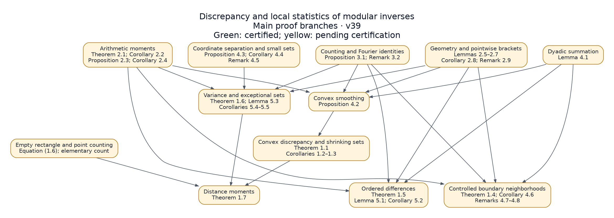

# Proof dependencies

This guide explains the dependency maps for **v39 of _Discrepancy and local statistics of modular inverses_**. The [inventory](INVENTORY.md) supplies statement summaries, source locators, supporting calculations, and literature references. The editable record is [`docs/dependency_inventory.json`](docs/dependency_inventory.json).

## Graph views

| View | Scope | Files |
| --- | --- | --- |
| Overview | 12 groups showing the main proof branches | [PDF](docs/dependency_overview.pdf) · [SVG](docs/dependency_overview.svg) · [PNG](docs/dependency_overview.png) · [DOT](docs/dependency_overview.dot) |
| Numbered statements | All 26 numbered results, five numbered remarks, and 6 groups of trusted references | [PDF](docs/dependency_graph.pdf) · [SVG](docs/dependency_graph.svg) · [PNG](docs/dependency_graph.png) · [DOT](docs/dependency_graph.dot) |
| Complete documented dependencies | 87 nodes: 31 numbered entries, 45 supporting steps, and 11 literature records; 136 edges | [PDF](docs/dependency_complete.pdf) · [SVG](docs/dependency_complete.svg) · [DOT](docs/dependency_complete.dot) |

[](docs/dependency_overview.pdf)

The PDF and SVG versions are intended for enlargement. The complete graph is a large reference diagram; the overview is the more useful first view. Nodes in the numbered and complete SVG/PDF exports link to their inventory entries when opened in a viewer that supports links.

## Meaning of an arrow

An arrow points **from a prerequisite to a statement or calculation that uses it**. The map describes the written proof, rather than the order of exposition.

| Appearance | Meaning |
| --- | --- |
| Solid grey arrow | A mathematical input: an identity, estimate, statement, or supporting calculation |
| Dashed purple arrow (`#8d79bc`) | A trusted literature input at the locator recorded in the inventory |
| Dashed grey arrow labelled **method reuse** | Reuse of an argument or explicit method attribution, distinct from use of the source result's numerical conclusion |
| Yellow node (`#fff4dc` fill, `#b88023` border) | An internal entry pending certification |
| Green node (`#e1f5df` fill, `#408342` border) | A certified internal entry; reserved for future certification |
| Box | A numbered statement; the label specifies its kind |
| Dashed box | A numbered remark |
| Ellipse | A supporting calculation or elementary fact in the manuscript |
| Purple hexagon (`#eeeafd` fill, `#7762b4` border) | A trusted literature record, including an explicitly credited method |
| Purple box in the reference row (same fill and border) | Trusted inputs grouped by reference work |

Formalization has not started, so every internal entry is currently pending (yellow). Pending records certification status, which is separate from the paper's mathematical audit. Green is reserved for certified entries; references are purple. Theorem 2.1 is a manuscript statement of a trusted BRS result: its literature source is purple, while its internal statement node remains pending certification.

**Literature convention:** cited literature results are trusted and are not reproved here. Their statements, hypotheses, parameter ranges, and normalizations must match each application. A credited construction that is proved again in the manuscript is distinguished from an external theorem assumed in a proof.

### How the smaller views are obtained

The **numbered-statement graph** suppresses supporting nodes while retaining the paths they connect between numbered statements. It transitively reduces solid arrows: when a recorded path already passes through an intermediate numbered result, the additional direct arrow is omitted from this view. The complete graph preserves the individual proof uses.

For example, the complete map records both the convex geometry of Lemma 2.7 and the smoothing estimate of Proposition 4.2 in the proof of Theorem 1.1. Since the geometry also enters the smoothing argument through Corollary 2.8, the numbered graph can suppress the additional direct geometry arrow. Its absence there does not mean that geometry is unused.

A separate row groups the literature records by their 6 reference works. Its 14 source arrows stop at the first numbered result using each input, possibly through supporting calculations. Method-only attributions are not converted into assumed mathematical inputs. Method edges between numbered entries are retained and labelled; method reuse between supporting calculations remains visible in the complete view.

The **overview** groups related statements and calculations. An arrow between groups means that part of the destination argument uses part of the source group; it does not assert that every item in one group uses every item in the other. Reference details are supplied by the numbered and complete views.

Every edge in the full JSON record has a reason. Actual TeX labels identify the numbered statements and labelled equations. Prefixes such as `step:`, `external:`, and `ov:` identify repository records, not new manuscript statements.

## 1. Arithmetic and Fourier inputs

[Theorem 2.1](INVENTORY.md#thm-brs-input) records the signed dyadic-frequency estimate of Blomer, Risager and Shparlinski. [Corollary 2.2](INVENTORY.md#cor-brs-cumulative) sums it over dyadic frequency ranges. Selberg's identity then reduces the two nonzero frequency variables to the one-variable estimate, while a separate Ramanujan-sum calculation treats the coordinate axes. This gives [Proposition 2.3](INVENTORY.md#prop-rectangular).

The cardinality comparison $N_X\asymp X^2$ normalizes the coefficients and yields the shell estimates in [Corollary 2.4](INVENTORY.md#cor-shell). The axes are included, while the zero frequency is excluded from these moments. The source record retains the distinct citations for Selberg's identity, Ramanujan sums, the divisor estimate, and the summatory totient estimate.

[Proposition 3.1](INVENTORY.md#prop-identities) supplies three identities: smooth counting, ordered differences, and variance for measurable indicators. Its supporting components record the finite sums, smooth Fourier inversion, and Parseval steps. Later edges identify the particular identity used. [Remark 3.2](INVENTORY.md#rem-overlap) records a direct overlap formula; it is not a consequence of either local-statistics theorem.

## 2. Convex geometry and discrepancy

[Lemma 2.5](INVENTORY.md#lem-translation) converts translation control into a Fourier tail estimate. [Lemma 2.6](INVENTORY.md#lem-brackets) constructs smooth pointwise upper and lower brackets with boundary-dependent integral error and Fourier control. The bracket construction has its own convolution and Parseval argument; it does not depend on the translation lemma's tail conclusion.

[Lemma 2.7](INVENTORY.md#lem-convex-geometry) establishes the geometric and Fourier estimates for convex sets, including boundary tubes, translations, the Fourier tail, and a pointwise coefficient bound. These feed the convex brackets of [Corollary 2.8](INVENTORY.md#cor-convex-brackets). The Euclidean norm notation in these estimates is retained as a norm, not interpreted as a coordinate.

[Proposition 4.2](INVENTORY.md#prop-smoothing) combines those brackets with Proposition 3.1's counting identity, the arithmetic shell estimate, Cauchy–Schwarz, and the dyadic sums of [Lemma 4.1](INVENTORY.md#lem-dyadic). Optimizing the smoothing scale in two perimeter regimes proves [Theorem 1.1](INVENTORY.md#thm-perimeter). The uniform perimeter bound gives [Corollary 1.2](INVENTORY.md#cor-isotropic); scaling the area and perimeter gives [Corollary 1.3](INVENTORY.md#cor-shrinking).

The small-perimeter branch has an elementary basis. Coordinate injectivity and denominator separation prove [Proposition 4.3](INVENTORY.md#prop-coordinate-separation), using the cardinality lower bound to normalize the count. [Corollary 4.4](INVENTORY.md#cor-small-perimeter-sharp) combines it with diagonal segments to determine the discrepancy order for very short perimeters. [Remark 4.5](INVENTORY.md#rem-positive-area) gives a positive-area example explaining the baseline term in Theorem 1.1. Those lower examples need only the elementary upper bound $N_X\le X^2$.

## 3. Sets with controlled boundary neighborhoods

[Theorem 1.4](INVENTORY.md#thm-boundary) has a separate smoothing proof under the hypothesis $b_E(s)\le Bs^\alpha$. It uses the general pointwise brackets, the translation lemma, the arithmetic shells, and the counting identity. The numerical convex estimate of Theorem 1.1 is not a prerequisite.

The proof needs a dyadic calculation uniform in $0<\alpha\le1$. One exponent can pass through zero, so the complete map keeps the direct estimate for that case as a supporting step. The resulting general smoothing inequality is optimized separately from Proposition 4.2.

[Corollary 4.6](INVENTORY.md#cor-well-shaped) first transfers the Euclidean definition of well-shapedness to a torus boundary-tube bound, including the strip near the boundary of the fundamental square. It then applies Theorem 1.4. The Koch example in [Remark 4.7](INVENTORY.md#rem-koch) uses the construction and dimension facts cited from Lapidus and Pearse. Its tube upper bound is proved in the manuscript. Its failure of well-shapedness uses the linear tube estimate established in Corollary 4.6's proof, rather than that corollary's discrepancy conclusion.

[Remark 4.8](INVENTORY.md#rem-topological-boundary) is a direct pointwise example: the test set consisting of all the modular-inverse points has measure zero and discrepancy one. It explains why the boundary conditions cannot be replaced by information that ignores changes on null sets. It has no artificial dependency on the theorem it explains.

## 4. Differences and local variance

[Theorem 1.5](INVENTORY.md#thm-differences) has two proof components. The convex component combines pointwise brackets, the difference identity of Proposition 3.1, and the squared arithmetic shell estimate. The rectangular component uses products of the arc brackets in [Lemma 5.1](INVENTORY.md#lem-arc-brackets), the rectangular arithmetic moment, and separate frequency sums. The exact diagonal-removal identity gives the distinct-pair extension. These ingredients also give [Corollary 5.2](INVENTORY.md#cor-difference-shrinking).

[Theorem 1.6](INVENTORY.md#thm-variance) uses the indicator variance identity without smoothing. For convex sets, it combines the Fourier tail and pointwise coefficient estimates with squared arithmetic shell bounds. The disc estimate is a specialization of this convex component. Products of coordinate arcs are treated through their unsmoothed coefficients and the rectangular moment estimate.

The rectangular variance argument reuses the frequency-block method from the difference proof. The complete map labels this relation **method reuse**; the numerical discrepancy estimate in Theorem 1.5 is not an input to Theorem 1.6.

[Lemma 5.3](INVENTORY.md#lem-one-point) proves the exact variance identity when every translate contains at most one point. Coordinate separation supplies the sufficient width conditions. The identity handles the very small sets in the variance proof. The map keeps this argument before the variance theorem, even though the identity is announced in the introductory statement, so there is no circular dependency.

Chebyshev's inequality applied to Theorem 1.6 gives [Corollary 5.4](INVENTORY.md#cor-variance-shrinking). [Corollary 5.5](INVENTORY.md#cor-simultaneous) uses the disc variance directly, together with a geometric grid of radii, a union bound, and monotonicity, to obtain one exceptional set for an interval of radii.

## 5. Distance moments

The upper and lower bounds in [Theorem 1.7](INVENTORY.md#thm-distance) have distinct inputs.

- **Upper bound:** the disc clause of Theorem 1.6 bounds the measure of centers of empty discs. Corollary 1.3 supplies a uniform upper cutoff for the distance. Integrating the tail up to this cutoff gives the moment bound.
- **Lower bounds:** elementary counting bounds the total area covered by small discs around all the points. An explicit empty rectangle, proved in the introduction, supplies a second lower bound at a larger distance scale. Together they give the stated exponent for all $s>0$.

BRS Section 1.2 is credited for the empty-box construction. The particular rectangle used here is verified directly in v39, so that citation is a method attribution rather than an unproved emptiness assertion.

The distance upper bound in this paper therefore depends on the discrepancy and variance branches. Section 6.4 leaves the precise factor at the critical moment $s=2$ undetermined. The graph does not import the independent elementary distance proof or sharper critical result from the companion paper.

## Definitions, background, and literature boundaries

The map records substantive steps in the written proofs. Definitions and ambient tools such as Cauchy–Schwarz, Chebyshev, Tonelli, finite-sum rearrangements, elementary denominator arithmetic, and elementary calculus are described where used without expanding them into a formal axiomatic foundation.

The [literature table](INVENTORY.md#literature-inputs) records locators as cited in v39. Comparisons with prior discrepancy estimates, angular Fourier decay, fixed-modulus statistics, and announced pair-correlation work do not create proof dependencies merely by appearing near a proof. The bibliography preserves those distinctions.

Section 6's four discussions are recorded separately. They include open questions about the discrepancy exponent, mean-spacing statistics, other test sets, and the critical distance moment. The sketched extension whose details are deferred is not counted as a proved numbered theorem.

## Regeneration and checks

Run from the repository root:

```bash
python3 scripts/build_dependency_graph.py --check
python3 scripts/build_dependency_graph.py
```

The first command checks the record's identifiers, edges, statement counts, source locators, certification status, overview coverage, and absence of directed cycles. The second also regenerates `INVENTORY.md` and the graphs; it requires Graphviz's `dot` executable.

The baseline was checked against the v39 TeX labels and compiled numbering. These checks establish consistency of the documented map; they do not certify the mathematics. A change of manuscript version requires a new fingerprint and a review of the affected statements and arrows.
