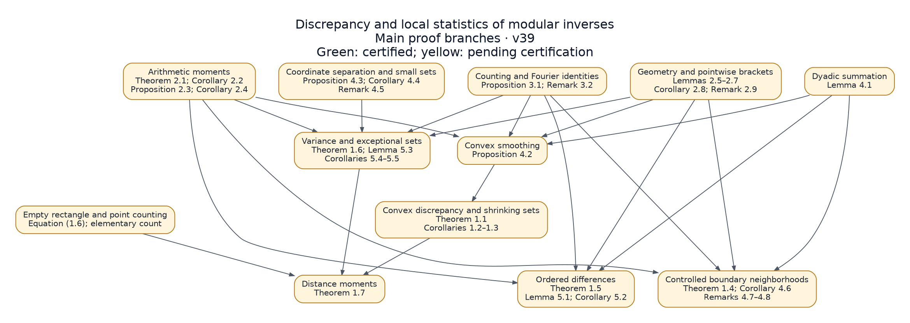

# Discrepancy and local statistics of modular inverses

**Debmalya Basak, Sneha Chaubey, Nicolas Robles, Igor E. Shparlinski, and Alexandru Zaharescu**

This repository documents the statements and proof dependencies of **v39** of the paper. It contains an inventory, three dependency graphs, and the data and script used to build them. The inventory covers **26 numbered results and five numbered remarks**.

**Current stage:** documentation. Formalization has not started. The manuscript itself is not included.

## Start here

| Resource | Contents |
| --- | --- |
| [Statement inventory](INVENTORY.md) | Every numbered theorem, corollary, proposition, lemma, and remark, with its TeX label, summary, source location, and proof inputs |
| [Dependency guide](DEPENDENCIES.md) | How to read the graphs, the main proof branches, and the distinction between mathematical inputs, proof-method reuse, and contextual references |
| [Overview graph](docs/dependency_overview.pdf) | The main proof branches on one page |
| [Numbered-statement graph](docs/dependency_graph.png) | All 31 numbered entries and 6 groups of trusted references, with supporting calculations suppressed |
| [Complete documented graph](docs/dependency_complete.pdf) | Numbered statements, 45 supporting steps, and 11 literature records |
| [Machine-readable inventory](docs/dependency_inventory.json) | Stable identifiers, source locators, and an explanation for each recorded dependency |

## Proof overview

[](docs/dependency_overview.pdf)

Open the [PDF](docs/dependency_overview.pdf) or [SVG](docs/dependency_overview.svg) to enlarge the figure. Arrows point from prerequisites to consequences. The overview groups related statements; the [dependency guide](DEPENDENCIES.md) explains the finer distinctions.

## Mathematical scope

The paper concerns the modular-inverse point set

$$
\mathcal P_X=\left\{(a/c,b/c)\in\mathbb T^2:
ab\equiv1\pmod c,\ 1\le a,b\le c\le X\right\},
\qquad N_X=\sum_{c\le X}\varphi(c),
$$

where the defining variables are integers. Write $\mu_X$ for its normalized counting measure, and let $D_X(E)=|\mu_X(E)-|E||$, with area measured on the unit torus. The proofs combine the Kloosterman-sum estimate of Blomer, Risager and Shparlinski with Fourier estimates that retain the size and geometry of the test set.

| Results | Content |
| --- | --- |
| [Theorem 1.1 and Corollaries 1.2–1.3](INVENTORY.md#thm-perimeter) | Discrepancy with explicit dependence on the perimeter, the isotropic discrepancy bound, and uniform relative asymptotics for shrinking convex shapes |
| [Theorem 1.4 and Corollary 4.6](INVENTORY.md#thm-boundary) | Discrepancy for sets whose topological boundary has a controlled tubular neighborhood, including well-shaped sets |
| [Theorem 1.5 and Corollary 5.2](INVENTORY.md#thm-differences) | Counts of ordered differences in convex sets and products of coordinate arcs, including shrinking sets and the removal of equal-point pairs |
| [Theorem 1.6 and Corollaries 5.4–5.5](INVENTORY.md#thm-variance) | Variance over translations, exceptional-set bounds, and one exceptional set valid for a range of disc radii |
| [Theorem 1.7](INVENTORY.md#thm-distance) | Positive moments of the distance to the point set, with a change in exponent at the second moment |

For example, [Theorem 1.1](INVENTORY.md#thm-perimeter) states that for $X\ge2$ and a convex set $\Omega$ lying in a translate of the half-open unit square, with perimeter $P$,

$$
D_X(\pi(\Omega))
\ll_\varepsilon X^\varepsilon
\left(X^{-1}+P^{2/3}X^{-2/3}\right).
$$

Here $\pi:\mathbb R^2\to\mathbb T^2$ is the quotient map. The bound is uniform in the position and orientation of the set. [Corollary 1.3](INVENTORY.md#cor-shrinking) gives relative asymptotics for a fixed positive-area convex shape at linear scales $t\ge X^{-1/2+\kappa}$, for fixed $0<\kappa<1/2$.

If $d_X(u)$ is the distance from $u\in\mathbb T^2$ to $\mathcal P_X$ in the flat torus metric, [Theorem 1.7](INVENTORY.md#thm-distance) gives, for fixed $s>0$ and every $\varepsilon>0$,

$$
X^{-\vartheta(s)}
\ll_s\int_{\mathbb T^2}d_X(u)^s\,du
\ll_{s,\varepsilon}X^{-\vartheta(s)+\varepsilon},
\qquad \vartheta(s)=\min\{s,1+s/2\}.
$$

The upper bound uses the disc variance and uniform shrinking-set estimates. The lower bounds use elementary point counting and an explicit empty rectangle. At $s=2$, v39 leaves the factor below the power scale undetermined. The inventory records that limitation and the other open directions in Section 6.

## Inventory and graph conventions

The numbered inventory contains **6 theorems, 10 corollaries, 6 lemmas, 4 propositions, and 5 remarks**. These counts include the imported BRS estimate stated as Theorem 2.1. Introductory results are counted once, at their statement numbers; their proof locations are recorded separately. Section 6 contains unnumbered discussion.

The complete documented graph has **87 nodes and 136 edges**. Supporting nodes identify substantive calculations already present in v39. Literature records identify particular cited results or explicit method attributions. Contextual references are distinguished from proof inputs.

**Literature convention:** cited literature results are treated as trusted inputs and are not reproved here. Their statements, hypotheses, parameter ranges, and normalizations must match each application. The [numbered-statement graph](docs/dependency_graph.png) shows these inputs in a separate reference row. [PDF](docs/dependency_graph.pdf) and [SVG](docs/dependency_graph.svg) versions are available for enlargement.

The graphs use the model repository's status colours: **purple** for trusted references, **green** for certified entries, and **yellow** for entries pending certification. Literature arrows are dashed purple. Dashed grey arrows labelled **method reuse** distinguish reuse of an argument from use of its numerical conclusion. The [dependency guide](DEPENDENCIES.md#meaning-of-an-arrow) records the exact palette.

Every internal entry is currently pending because formalization has not started. Pending is a certification status, separate from the paper's mathematical audit. The inventory distinguishes statements proved in the manuscript from cited inputs. There are no Lean files or formal build targets.

## Source baseline

All statement numbers and source locations refer to the following author-held file:

| Field | Value |
| --- | --- |
| Version | v39 |
| Source filename | `modular_inverse_discrepancy_v39.tex` |
| SHA-256 | `03bb313d26bb491a742178ce0051f646c0af19b12af4ce3662577b481b93e2db` |
| Documentation baseline date | 2026-11-25 |

The reattached copy, `modular_inverse_discrepancy_v39(1).tex`, has the same contents and fingerprint. The repository contains summaries and locators, not the manuscript source or its PDF.

## Regenerate the documentation

The editable record is [`docs/dependency_inventory.json`](docs/dependency_inventory.json). Python 3 validates it and generates the inventory and DOT files; Graphviz's `dot` renders the SVG, PDF, and PNG figures.

```bash
# Validate the record without writing files or requiring Graphviz.
python3 scripts/build_dependency_graph.py --check

# Regenerate INVENTORY.md and all graph files; requires Graphviz.
python3 scripts/build_dependency_graph.py
```

When the manuscript changes, update the source fingerprint, affected entries, and dependency reasons together. Regenerate the files and review the resulting diff. The manuscript is not needed to render the existing record.

## Related repositories

The organization and status palette follow [quaternary-quadratic-forms](https://github.com/nicolasrobles/quaternary-quadratic-forms), as inspected at [commit b0465ef](https://github.com/nicolasrobles/quaternary-quadratic-forms/tree/b0465efa32fae600039f120094d10f7e533f8cd3). The companion repository [modular_inverses_ii](https://github.com/nicolasrobles/modular_inverses_ii) documents the second paper. This repository's statements and dependencies refer specifically to v39 of the first paper.
